  

<h1 align="center">Hey, I'm Ajaj Ali 👋</h1>

<h3 align="center">
  AI Engineer | GenAI | Agentic AI | Voice AI
</h3>

  
  
  
  

  

---

## 🧠 About Me

I'm an **Applied AI Engineer with 2+ years of experience** building and deploying AI systems that solve real-world problems.

My work spans **LLMs, Retrieval-Augmented Generation (RAG), Agentic AI, Conversational AI, and real-time Voice AI** — from designing intelligent systems to optimizing their performance in production.

Currently, I work at **Oriserve**, building AI-powered solutions for enterprise applications across customer support, conversational automation, and speech technologies.

### ⚡ What I Build

- **Agentic AI:** ReAct agents, tool calling, multi-step reasoning, and LangGraph workflows.
- **RAG Systems:** Hybrid retrieval, semantic search, reranking, and knowledge-grounded generation.
- **Voice AI:** Real-time streaming Speech-to-Speech, conversational pipelines, and multilingual TTS.
- **LLM Infrastructure:** Model serving, inference optimization, deployment, and scalable AI APIs.
- **Speech ML:** STT/TTS training data, audio enhancement, denoising, and VAD pipelines.

### 📈 Engineering Impact

<table align="center">
  <tr>
    <td align="center">
      <h2> &lt;1s </h2>
      <b>Voice AI Response</b>
       
      Streaming Speech-to-Speech
    </td>
    <td align="center">
      <h2>80%</h2>
      <b>Cost Reduction</b>
       
      Production Voice Pipeline
    </td>
    <td align="center">
      <h2>17</h2>
      <b>Indian Languages</b>
       
      Multilingual TTS
    </td>
    <td align="center">
      <h2>60K+</h2>
      <b>Documents</b>
       
      Processed for AI systems
    </td>
  </tr>
</table>

---

## 🏗️ Technical Expertise

  

### Generative AI & Agentic Systems

  
  
  
  
  
  
  
  
  

### Voice AI & Speech Engineering

  
  
  
  
  
  

### Model Serving & Infrastructure

  
  
  
  
  
  
  
  

### ML, Data & Storage

  
  
  
  
  
  
  
  

---

## 🚀 Featured Projects

  

### 🎙️ OriTTS — Multilingual Voice Generation

Production-oriented multilingual TTS supporting **17 Indian languages**, built for natural speech generation and real-time streaming.

**Focus:** Multilingual synthesis · Text normalization · Streaming inference

**Stack:** PyTorch · Hugging Face · TTS

🔗 [Explore my Hugging Face profile](https://huggingface.co/ajajali09)

### 🧩 Text Preprocessor for TTS

A configurable text normalization pipeline for multilingual speech synthesis, handling numbers, dates, currencies, symbols, abbreviations, and language-specific text processing.

**Focus:** Text normalization · Pronunciation consistency · Multilingual NLP

**Stack:** Python · NLP · Regex

🔗 [View Repository](https://github.com/Ajaj-Ali/text_preprocessor_for_TTS)

### 🗣️ ARIA — Audio Responsive Intelligent Assistant

A multilingual conversational Voice AI assistant with real-time interaction using Faster-Whisper, Ollama/Qwen2-7B, and XTTS.

**Focus:** Streaming speech interaction · Language detection · Speech-to-text · Text-to-speech

**Stack:** Django Channels · WebSockets · Faster-Whisper · XTTS

🔗 [Explore GitHub Projects](https://github.com/Ajaj-Ali)

---

## 🎧 Speech Data Engineering

Built and maintained end-to-end data pipelines for speech AI, converting raw audio into structured, high-quality datasets for STT and TTS development.

| Pipeline Stage | Engineering Work |
|---|---|
| **Data Collection** | Sourced 9,000+ hours of audio and 60,000+ documents |
| **Audio Processing** | Denoising, enhancement, and artifact removal |
| **Segmentation** | VAD-based speech segmentation and silence removal |
| **Quality Control** | Standardized preprocessing and dataset validation |
| **Model Enablement** | Prepared structured speech datasets for STT/TTS training |

**Stack:** Python · Audio Signal Processing · VAD · Pandas · Data Pipelines

---

## 📊 GitHub Analytics

  
  

  

  

---

## 🤝 Let's Connect

  <i>Interested in Applied AI, GenAI, Agentic Systems, or Voice AI?</i>
    
  <a href="https://www.linkedin.com/in/ajaj-ali/">LinkedIn</a> ·
  <a href="mailto:ajajali7534@gmail.com">Email</a> ·
  <a href="https://huggingface.co/ajajali09">Hugging Face</a> ·
  <a href="https://github.com/Ajaj-Ali">GitHub</a>

  

